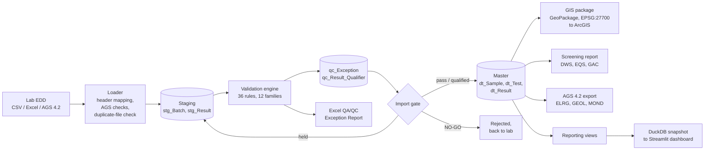
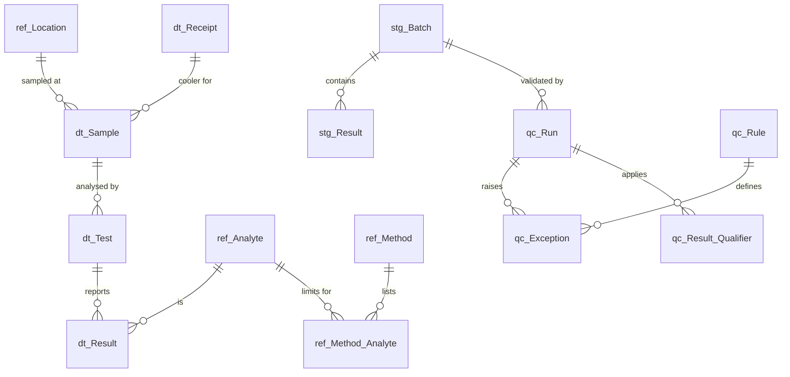

# Automated Environmental QA/QC & EDD Validation Engine

A Python and SQL Server pipeline that checks laboratory Electronic Data Deliverables (EDDs) before they reach a master environmental database. It loads raw lab files (CSV, Excel or AGS 4.2) into staging, runs 36 automated QA/QC rules, writes a formatted QA/QC Exception Report, and only promotes data that passes the gate. Validated data is then screened against UK criteria, exported as AGS 4.2, packaged for ArcGIS and published to a dashboard.

**Dashboard:** [EDD QA/QC Dashboard](https://github.com/PriyankaSagwekar/EDD-QC-Dashboard) (Streamlit; the live link is in that repo once deployed).

The workflow mirrors how EDDs are handled in systems such as EQuIS on ground investigation and groundwater monitoring projects. The data model follows the same location, sample, test and result structure.

**Skills shown:** EDD management, QA/QC data validation, SQL Server (T-SQL, views, stored procedures), Python automation (pandas, SQLAlchemy), AGS 4.2 data transfer, screening against UK criteria, GIS (GeoPackage in British National Grid, ArcGIS), dashboards (Streamlit), automated testing.

> The site, laboratory and all data are fictional and simulated. Screening criteria are illustrative values only and must not be used for real assessment.

---

## How it works



1. **Load.** The loader reads the EDD, maps common header variants to standard names, checks required columns, and refuses a file that was already loaded. Every row lands in staging as text, exactly as received.
2. **Validate.** The engine runs every rule family in order. Limits come from reference tables in SQL Server, not from code, so a data manager can change a holding time or recovery limit without touching Python.
3. **Qualify.** Each failed check logs an exception against the row that triggered it. It can also apply a validator qualifier to associated results. For example, a failed surrogate qualifies every target result in that sample.
4. **Report.** A formatted Excel workbook gives the import decision, counts by rule, a sheet per rule family, every qualified result, and a promoted-versus-held summary per sample.
5. **Gate.** The stored procedure `usp_Promote_Batch` moves passed and qualified rows to the master tables in one transaction. Rows with critical failures or an R (rejected) qualifier stay in staging. If more than 10% of a file is held, the batch is NO-GO and goes back to the laboratory.
6. **Use the validated data.** Usable results are screened against criteria sets, exported as AGS 4.2, written to a GeoPackage for ArcGIS, and copied to a DuckDB snapshot that the dashboard reads.

---

## QA/QC rules

| Family | Rules | What is checked |
|---|---|---|
| Completeness | COMP-01 to 05 | Required fields, valid codes, numbers and dates that parse, duplicate rows, units against the method |
| Referential integrity | REF-01 to 05 | Unknown locations, methods or CAS numbers, missing QC parent samples, missing method or trip blanks, conflicting sample headers |
| Structural / depth | STR-01 to 05 | Depth top below base, depth below borehole base, soil samples without depths, groundwater samples outside the well screen, illogical dates, duplicate sampling |
| Thermal preservation | PRES-01 to 03 | Cooler temperature outside 0 to 6 °C, unpreserved bottles (pH), broken custody seals |
| Holding time | HT-01, HT-02 | Sampling to analysis, and sampling to extraction, against method holding times |
| Detection boundary | DET-01 to 05 | Detects below the MDL, unflagged results between MDL and RL, non-detects carrying values, RLs above screening criteria, inconsistent limits |
| Blank contamination | BLK-01 to 03 | Method, field, equipment and trip blank detects above the MDL, with the 5x and 10x action levels applied to associated samples |
| Surrogates | SUR-01 | Surrogate recovery outside limits, for example 70 to 130% |
| Matrix spike | MS-01 to 03 | MS/MSD recovery, MS/MSD RPD, and spikes that cannot be assessed because the parent is too high |
| Lab control sample | LCS-01 | LCS recovery outside limits, applied to the whole lab batch |
| Field duplicates | FD-01 | RPD against the parent, or absolute difference near the RL |
| Plausibility | PLB-01, 02 | Dissolved metal above total, sum of BTEX or TPH bands above the reported total |

Severity sets the outcome. **CRITICAL** findings hold the row in staging. **WARNING** findings qualify results. **INFO** findings are recorded only. Recoveries below 10%, holding times more than twice the limit, and coolers above 10 °C escalate to CRITICAL with an R qualifier.

### Validator qualifiers

Qualifier codes follow the US EPA National Functional Guidelines conventions that EQuIS uses by default. When several rules qualify one result, they are combined using the precedence R > UJ > J+/J- > J > U > B. The rule IDs behind each qualifier are kept in `validator_reason`, so HT-01 in the reason marks a holding time exceedance.

| Code | Meaning |
|---|---|
| U | Not detected at the reported limit |
| J | Estimated value |
| J+ / J- | Estimated, likely biased high / low |
| UJ | Not detected, and the reported limit is estimated |
| B | Analyte also found in an associated blank |
| R | Rejected, unusable |

---

## Data model



| Layer | Tables | Purpose |
|---|---|---|
| Reference (`ref_`) | Site, Location, Lab, Analyte, Method, Method_Analyte, Surrogate_Limit, Spike_Limit, Screening_Criterion, Valid_Value | Lookup values and every QC limit. Locations carry British National Grid coordinates, final depth and well screen. |
| Ground investigation (`ref_`) | Geology, Water_Strike, Water_Strike_Reading, Water_Level | Fictional borehole logs, water strikes with their rise, and groundwater dips at each monitoring round |
| Staging (`stg_`) | Batch, Result | Raw EDD rows as received, plus the final qualifier and status from validation |
| QC (`qc_`) | Rule, Run, Exception, Result_Qualifier | Rule catalogue, audit trail of each validation run, every finding and every qualifier applied |
| Master (`dt_`) | Sample, Receipt, Test, Result | Validated data only |

Reporting views (`sql/07`, `sql/09`). The Excel reports, GIS package and dashboard all read these, so every output shows the same numbers.

| View | Answers |
|---|---|
| `vw_Exception_Summary`, `vw_Exception_Detail` | Exceptions by batch, rule and severity; every finding of the latest run |
| `vw_Batch_Summary` | Rows passed, qualified and held per EDD; held fraction against the NO-GO limit |
| `vw_Qualifier_Summary`, `vw_Held_Rows` | Final qualifiers on promoted results; rows kept in staging and why |
| `vw_Location_QC_Status` | Red, amber or green per location, with British National Grid coordinates |
| `vw_Result_Validated`, `vw_Result_Timeseries` | Validated master results; plot-ready series with non-detects at the RL and the criterion |
| `vw_Screening_Exceedance`, `vw_Screening_Summary`, `vw_Screening_Location` | Each usable result against each criteria set; worst result per location and analyte; worst exceedance per location |

---

## Simulated data

The simulator creates a fictional site, Riverside Industrial Estate in West Yorkshire. It has 10 monitoring wells, 3 boreholes and 2 trial pits. There are four quarterly groundwater rounds and two soil investigation phases, giving six lab EDDs of about 850 to 900 rows each. The analytical suite is metals (total and dissolved), BTEX and chlorinated VOCs, speciated PAH-16 and TPH CWG bands. Every batch includes field duplicates, field or equipment blanks, trip blanks, method blanks, LCS and MS/MSD samples, plus surrogates. The concentrations follow a simple site model: a hydrocarbon plume around MW03 to MW05, a chlorinated solvent plume around MW07 to MW09, and made ground with metals and PAHs in shallow soils.

The ground investigation data follow a simple ground model: made ground over alluvial silty clay, over River Terrace gravel (the aquifer), over Coal Measures mudstone. Every well screen sits below the clay. Water is struck at the top of the gravel and rises under the clay, and each well is dipped before it is sampled, with groundwater shallowest in late winter. Layer depths vary by location from a fixed seed, so every run gives the same logs.

The laboratory data are generated clean first, then specific defects are injected. Each injected defect is written to an answer key in `data/answer_keys/`, so the tests can prove the engine catches it.

### Results from the demonstration run

| File | Rows | Passed | Qualified | Held | Decision |
|---|---|---|---|---|---|
| FAL_EDD_2601_GW.csv | 842 | 816 | 23 | 3 | Partial |
| FAL_EDD_2602_SO.xlsx | 895 | 792 | 6 | 97 | NO-GO, rejected |
| FAL_EDD_2604_GW.csv | 878 | 797 | 25 | 56 | Partial |
| FAL_EDD_2606_SO.xlsx | 908 | 835 | 17 | 56 | Partial |
| FAL_EDD_2607_GW.csv | 896 | 523 | 356 | 17 | Partial |
| FAL_EDD_2609_GW.csv | 841 | 757 | 28 | 56 | Partial |

All 53 injected defects were caught. Clean files produce zero exceptions. Master row counts reconcile exactly with promoted staging rows.

---

## Using the validated data

### Screening report
`python -m eddqc screen` writes `data/reports/Screening_<set>.xlsx` for each criteria set: an illustrative UK drinking water standard (DWS) and freshwater EQS for groundwater, and a residential GAC for soil. Only usable results for primary samples are screened. Each result is classed as **Exceeds**, **Below**, **ND compliant**, or **ND inconclusive** when the reporting limit is above the criterion, because such a non-detect cannot show compliance. The primary set for each matrix also drives rule DET-04 and the criterion line on charts.

### AGS 4.2
`python -m eddqc ags-export` writes the promoted data as AGS 4.2:
- **Laboratory results:** PROJ, TRAN, TYPE, UNIT, ABBR, DICT, LOCA, MONG, SAMP, CHOC and ELRG (ERES was removed in 4.2).
- **Ground investigation data** for the same locations:
  - GEOL: geology, with AGS legend codes such as 501 GRAVEL. The stratum codes have no approved AGS list, so they are declared as project codes.
  - WSTG and WSTD: water strikes and their rise.
  - MOND: depth-to-water dips, reading type `WDEP`.

Determinand codes, abbreviations and units follow the AGS code lists, for example ELRG_CODE P1374 for m,p-xylenes and the case-sensitive unit `ug/l`. Cooler temperature, custody seal, pH, extraction date and spike data travel as user-defined headings declared in DICT. Every file is checked against the AGS 4.2 rules before it is written.

`.ags` files are also accepted as input (`load`, `ags-import`, `run-all`). They are checked first, converted to EDD rows and run through the same 36 rules, and exceptions point at the line in the AGS file. Files from AGS 4.0 and 4.1, including the old ERES results group, are still loaded, with a version warning.

`python -m eddqc ags-check <file>` checks any AGS file. Add `--strict` to accept AGS 4.2 only. The AGS code lists (ABBR, UNITS, DATATYPES, ELRG) are in `docs/reference/ags/`, credited to the AGS in `SOURCE.md`. Only their AGS 4.2 rows are used, and each code or unit a file uses is reported by its AGS status:

| AGS status | Reported as |
|---|---|
| Approved | No issue |
| Accepted | Note |
| Proposed | Warning |
| Deprecated | Warning |
| Declined | Error |

The export itself writes only Approved codes, or project codes declared in ABBR.

The [dashboard](https://github.com/PriyankaSagwekar/EDD-QC-Dashboard) has an AGS viewer page. It checks an uploaded AGS 4.2 file and draws a borehole log and groundwater level charts from it.

### GIS package and ArcGIS
`gis-export` (also run by `run-all`) writes `data/gis/site_qc.gpkg` in British National Grid (EPSG:27700): QC status and screening points, plus time-series and screening tables that relate on `location_code`. [docs/ARCGIS_GUIDE.md](docs/ARCGIS_GUIDE.md) covers the ArcGIS Pro report figure and the ArcGIS Online maps embedded in the dashboard.

### Dashboard
The [dashboard repo](https://github.com/PriyankaSagwekar/EDD-QC-Dashboard) holds a Streamlit app with seven pages: overview, exceptions, batch detail, site map, results explorer, screening and the AGS viewer. Its `refresh_data.py` copies the reporting views from this database into a DuckDB file. The hosted app reads that snapshot and never connects to SQL Server.

---

## Running it

Requirements: Windows with SQL Server (Express is enough), ODBC Driver 17 or 18 for SQL Server, `sqlcmd`, and Python 3.11 or later. Connection settings are in `config/settings.toml`.

```powershell
python -m venv .venv
.\.venv\Scripts\python.exe -m pip install -e .[dev]

.\.venv\Scripts\python.exe -m eddqc init-db --reset     # build EnvDataQC and seed reference data
.\.venv\Scripts\python.exe -m eddqc simulate --seed 42  # write 6 EDDs to data/incoming
.\.venv\Scripts\python.exe -m eddqc run-all             # load, validate, report, promote, GIS export
.\.venv\Scripts\python.exe -m eddqc status              # list batches
```

Each step can also be run on its own:

```powershell
python -m eddqc load data\incoming\FAL_EDD_2601_GW.csv
python -m eddqc validate --batch 1
python -m eddqc report --batch 1
python -m eddqc promote --batch 1
python -m eddqc gis-export
python -m eddqc screen --set DWS
python -m eddqc ags-export --include-lab-qc
python -m eddqc ags-check --strict data\ags\RIE01_20261102.ags
python -m eddqc load path\to\lab_file.ags
```

Tests:

```powershell
.\.venv\Scripts\python.exe -m pytest
```

The rule and AGS tests run without a database. The AGS tests round-trip all six simulated EDDs and check that every QA/QC finding and qualifier is unchanged. The pipeline test builds and then drops a separate `EnvDataQC_Test` database, checks the reporting views, screening workbooks and GeoPackage, and re-imports an AGS export. It is skipped if SQL Server cannot be reached.

---

## Project layout

```
config/settings.toml        connection, paths, NO-GO threshold
sql/                        01-09: database, tables, seed data, views, promotion procedure, dashboard views
src/eddqc/
  refdata.py                site, analytes, methods, limits, ground model, rule catalogue (source of the seed SQL)
  site_investigation.py     fictional geology logs, water strikes and groundwater dips
  simulate.py               EDD generator with defect injection and answer keys
  loader.py                 CSV/Excel/AGS reader, header aliases, staging load
  rules/                    one module per rule family, plus qualifier precedence
  engine.py                 runs the rules, writes exceptions and statuses
  report.py                 Excel QA/QC Exception Report
  screening.py              screening workbook per criteria set
  ags/                      AGS 4.2 dictionary subset, writer, reader, checker, code lists, database export
  gis_export.py             location QC status (CSV, GeoJSON) and the ArcGIS GeoPackage
  cli.py                    command line
tests/                      rule edge cases, answer-key recall, AGS round trips, SQL Server pipeline
data/                       incoming, processed, rejected, reports, answer_keys, gis, ags
docs/                       plans, ArcGIS guide, AGS code lists (reference/ags)
```

## Design choices

- **Limits live in the database.** Holding times, MDLs, recovery limits and criteria are rows in reference tables. Switching a rule off is a change to `qc_Rule.active`.
- **Staging keeps the file as delivered.** Nothing is corrected on the way in, so the exception report always points at the exact line in the lab's file.
- **Row-level gate, file-level escape hatch.** One bad row should not block a whole round of monitoring data. A badly broken file should still go back to the lab.
- **Tests use answer keys.** Because the simulator knows every defect it injected, the tests measure what the engine catches and also prove that clean data raises no false alarms.

## Roadmap

- Groundwater-specific checks such as ion balance and field versus lab pH and conductivity.
- A live cloud database (for example Azure SQL) behind the dashboard instead of a snapshot.
- Power BI reports on the same reporting views.
