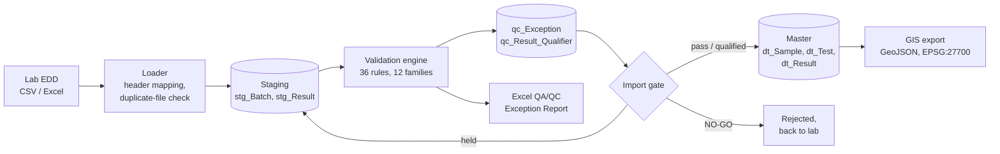
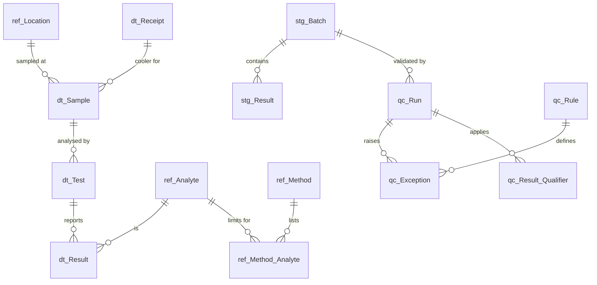

# Automated Environmental QA/QC & EDD Validation Engine

A Python and SQL Server pipeline that checks laboratory Electronic Data Deliverables (EDDs) before they reach a master environmental database. It loads raw lab files (CSV or Excel) into staging, runs 36 automated QA/QC rules, writes a formatted QA/QC Exception Report, and only promotes data that passes the gate.

The workflow mirrors how EDDs are handled in systems such as EQuIS on ground investigation and groundwater monitoring projects. The data model follows the same location, sample, test and result structure.

**Skills shown:** EDD management, QA/QC data validation, SQL Server (T-SQL, views, stored procedures), Python automation (pandas, SQLAlchemy), reporting, GIS-ready outputs, automated testing.

> The site, laboratory and all data are fictional and simulated. Screening criteria are illustrative values only and must not be used for real assessment.

---

## How it works



1. **Load.** The loader reads the EDD, maps common header variants to standard names, checks required columns, and refuses a file that was already loaded. Every row lands in staging as text, exactly as received.
2. **Validate.** The engine runs every rule family in order. Limits come from reference tables in SQL Server, not from code, so a data manager can change a holding time or recovery limit without touching Python.
3. **Qualify.** Each failed check logs an exception against the row that triggered it. It can also apply a validator qualifier to associated results. For example, a failed surrogate qualifies every target result in that sample.
4. **Report.** A formatted Excel workbook gives the import decision, counts by rule, a sheet per rule family, every qualified result, and a promoted-versus-held summary per sample.
5. **Gate.** The stored procedure `usp_Promote_Batch` moves passed and qualified rows to the master tables in one transaction. Rows with critical failures or an R (rejected) qualifier stay in staging. If more than 10% of a file is held, the batch is NO-GO and goes back to the laboratory.

---

## QA/QC rules

| Family | Rules | What is checked |
|---|---|---|
| Completeness | COMP-01 to 05 | Required fields, valid codes, numbers and dates that parse, duplicate rows, units against the method |
| Referential integrity | REF-01 to 05 | Unknown locations, methods or CAS numbers, missing QC parent samples, missing method or trip blanks, conflicting sample headers |
| Structural / depth | STR-01 to 05 | Depth top below base, depth below borehole base, soil samples without depths, groundwater samples outside the well screen, illogical dates, duplicate sampling |
| Thermal preservation | PRES-01 to 03 | Cooler temperature outside 0 to 6 °C, unpreserved bottles (pH), broken custody seals |
| Holding time | HT-01, HT-02 | Sampling to analysis, and sampling to extraction, against method holding times |
| Detection boundary | DET-01 to 05 | Detects below the MDL, unflagged results between MDL and RL, non-detects carrying values, RLs above screening criteria, inconsistent limits |
| Blank contamination | BLK-01 to 03 | Method, field, equipment and trip blank detects above the MDL, with the 5x and 10x action levels applied to associated samples |
| Surrogates | SUR-01 | Surrogate recovery outside limits, for example 70 to 130% |
| Matrix spike | MS-01 to 03 | MS/MSD recovery, MS/MSD RPD, and spikes that cannot be assessed because the parent is too high |
| Lab control sample | LCS-01 | LCS recovery outside limits, applied to the whole lab batch |
| Field duplicates | FD-01 | RPD against the parent, or absolute difference near the RL |
| Plausibility | PLB-01, 02 | Dissolved metal above total, sum of BTEX or TPH bands above the reported total |

Severity sets the outcome. **CRITICAL** findings hold the row in staging. **WARNING** findings qualify results. **INFO** findings are recorded only. Recoveries below 10%, holding times more than twice the limit, and coolers above 10 °C escalate to CRITICAL with an R qualifier.

### Validator qualifiers

Qualifier codes follow the US EPA National Functional Guidelines conventions that EQuIS uses by default. When several rules qualify one result, they are combined using the precedence R > UJ > J+/J- > J > U > B. The rule IDs behind each qualifier are kept in `validator_reason`, so HT-01 in the reason marks a holding time exceedance.

| Code | Meaning |
|---|---|
| U | Not detected at the reported limit |
| J | Estimated value |
| J+ / J- | Estimated, likely biased high / low |
| UJ | Not detected, and the reported limit is estimated |
| B | Analyte also found in an associated blank |
| R | Rejected, unusable |

---

## Data model



| Layer | Tables | Purpose |
|---|---|---|
| Reference (`ref_`) | Site, Location, Lab, Analyte, Method, Method_Analyte, Surrogate_Limit, Spike_Limit, Screening_Criterion, Valid_Value | Lookup values and every QC limit. Locations carry British National Grid coordinates, final depth and well screen. |
| Staging (`stg_`) | Batch, Result | Raw EDD rows as received, plus the final qualifier and status from validation |
| QC (`qc_`) | Rule, Run, Exception, Result_Qualifier | Rule catalogue, audit trail of each validation run, every finding and every qualifier applied |
| Master (`dt_`) | Sample, Receipt, Test, Result | Validated data only |

Reporting views: `vw_Exception_Summary`, `vw_Location_QC_Status` (red, amber or green per location, for GIS) and `vw_Result_Validated`.

---

## Simulated data

The simulator creates a fictional site, Riverside Industrial Estate in West Yorkshire. It has 10 monitoring wells, 3 boreholes and 2 trial pits. There are four quarterly groundwater rounds and two soil investigation phases, giving six lab EDDs of about 850 to 900 rows each. The analytical suite is metals (total and dissolved), BTEX and chlorinated VOCs, speciated PAH-16 and TPH CWG bands. Every batch includes field duplicates, field or equipment blanks, trip blanks, method blanks, LCS and MS/MSD samples, plus surrogates. The concentrations follow a simple site model: a hydrocarbon plume around MW03 to MW05, a chlorinated solvent plume around MW07 to MW09, and made ground with metals and PAHs in shallow soils.

The data are generated clean first, then specific defects are injected. Each injected defect is written to an answer key in `data/answer_keys/`, so the tests can prove the engine catches it.

### Results from the demonstration run

| File | Rows | Passed | Qualified | Held | Decision |
|---|---|---|---|---|---|
| FAL_EDD_2601_GW.csv | 842 | 816 | 23 | 3 | Partial |
| FAL_EDD_2602_SO.xlsx | 895 | 792 | 6 | 97 | NO-GO, rejected |
| FAL_EDD_2604_GW.csv | 878 | 797 | 25 | 56 | Partial |
| FAL_EDD_2606_SO.xlsx | 908 | 835 | 17 | 56 | Partial |
| FAL_EDD_2607_GW.csv | 896 | 523 | 356 | 17 | Partial |
| FAL_EDD_2609_GW.csv | 841 | 757 | 28 | 56 | Partial |

All 53 injected defects were caught. Clean files produce zero exceptions. Master row counts reconcile exactly with promoted staging rows.

---

## Running it

Requirements: Windows with SQL Server (Express is enough), ODBC Driver 17 or 18 for SQL Server, `sqlcmd`, and Python 3.11 or later. Connection settings are in `config/settings.toml`.

```powershell
python -m venv .venv
.\.venv\Scripts\python.exe -m pip install -e .[dev]

.\.venv\Scripts\python.exe -m eddqc init-db --reset     # build EnvDataQC and seed reference data
.\.venv\Scripts\python.exe -m eddqc simulate --seed 42  # write 6 EDDs to data/incoming
.\.venv\Scripts\python.exe -m eddqc run-all             # load, validate, report, promote, GIS export
.\.venv\Scripts\python.exe -m eddqc status              # list batches
```

Each step can also be run on its own:

```powershell
python -m eddqc load data\incoming\FAL_EDD_2601_GW.csv
python -m eddqc validate --batch 1
python -m eddqc report --batch 1
python -m eddqc promote --batch 1
python -m eddqc gis-export
```

Tests:

```powershell
.\.venv\Scripts\python.exe -m pytest
```

The rule tests run without a database. The pipeline test builds and then drops a separate `EnvDataQC_Test` database, and is skipped if SQL Server cannot be reached.

---

## Project layout

```
config/settings.toml        connection, paths, NO-GO threshold
sql/                        01-08: database, tables, seed data, views, promotion procedure
src/eddqc/
  refdata.py                site, analytes, methods, limits, rule catalogue (source of the seed SQL)
  simulate.py               EDD generator with defect injection and answer keys
  loader.py                 CSV/Excel reader, header aliases, staging load
  rules/                    one module per rule family, plus qualifier precedence
  engine.py                 runs the rules, writes exceptions and statuses
  report.py                 Excel QA/QC Exception Report
  gis_export.py             location QC status as CSV and GeoJSON
  cli.py                    command line
tests/                      rule edge cases, answer-key recall, SQL Server pipeline
data/                       incoming, processed, rejected, reports, answer_keys, gis
```

## Design choices

- **Limits live in the database.** Holding times, MDLs, recovery limits and criteria are rows in reference tables. Switching a rule off is a change to `qc_Rule.active`.
- **Staging keeps the file as delivered.** Nothing is corrected on the way in, so the exception report always points at the exact line in the lab's file.
- **Row-level gate, file-level escape hatch.** One bad row should not block a whole round of monitoring data. A badly broken file should still go back to the lab.
- **Tests use answer keys.** Because the simulator knows every defect it injected, the tests measure what the engine catches and also prove that clean data raises no false alarms.

## Roadmap

- AGS4 import and export (SAMP and ERES groups) alongside the EQuIS-style EDD.
- A dashboard in Power BI or Streamlit on top of the reporting views.
- A screening report against UK groundwater and soil criteria, using the existing criteria table.
- Groundwater-specific checks such as ion balance and field versus lab pH and conductivity.
- An ArcGIS Pro map layout using the GeoJSON export.
